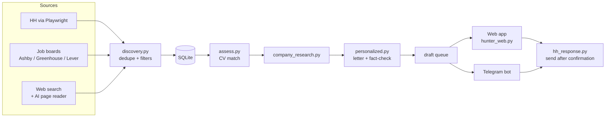

# AI Job Hunter

A personal, local-first AI assistant for a junior AI/ML job search. It collects vacancies from
HeadHunter (hh.kz / hh.ru), company job boards and the open web, filters out what does not fit,
checks every remaining vacancy against the candidate's real CV and prepares an individual,
fact-checked cover letter. The candidate reviews everything in a local web app or in Telegram;
nothing is sent to an employer without an explicit per-vacancy confirmation.

> The user interface and the letters are in Russian (the target market is Kazakhstan);
> the code, comments and this README are in English. A detailed user guide in Russian is in
> [docs/USER_GUIDE.ru.md](docs/USER_GUIDE.ru.md).

## The problem

A junior AI/ML candidate in Kazakhstan spends hours a day on routine work:

- vacancies are spread over HH, company career pages, job boards and aggregators;
- most of them do not fit: senior roles, the wrong city, or "remote" positions that hire only in the US;
- a good letter needs the vacancy, the company and the candidate's own experience, so each one takes 20–30 minutes;
- generic AI letters invent experience, technologies and numbers. For a job seeker this is worse than no letter.

AI Job Hunter automates the routine and keeps the candidate in control. The AI only proposes;
code checks every claim the AI makes against its sources, and only a person can send an application.

## What it does

| Stage | How |
|---|---|
| **Collect** | HH search through a real browser session (Playwright); Ashby / Greenhouse / Lever boards; career pages with `JobPosting` markup; web search through OpenRouter; an LLM reads job pages that have no markup. |
| **Filter** | Deterministic rules: role groups, freshness, excluded words and companies, geography (an office in the candidate's city, or remote work that accepts the candidate's country). Duplicates are merged; closed vacancies are archived. |
| **Assess** | An LLM matches vacancy requirements with CV fragments and returns a decision (*apply* / *apply with caveats* / *skip*), the matches, the gaps and the best CV variant. |
| **Write** | Short research on the company from its official sources, then an individual letter in Russian or English. A second, stronger model fact-checks the letter against the sources; a letter with unsupported claims gets one rewrite or goes to *Needs attention*. |
| **Review** | A local web app, a console menu and a Telegram bot: read, edit, postpone, reject, rewrite with AI by instruction, download the right CV. |
| **Apply** | On HH the program opens and fills in the form, then sends it only after a one-time confirmation (a 4-digit code in Telegram, or an exact phrase in the app). For other sites it gives a link and the letter for manual sending. |
| **Schedule** | Windows Task Scheduler runs the preparation at 10:00 and 18:00; the bot sends one summary message per run. |

## How the AI is kept honest

This was the main design goal, and most of the tests (424 in total) cover it.

- **Evidence by reference, not by quotation.** For the assessment the model sees numbered
  requirement fragments and numbered CV fragments and answers with their IDs. The code puts the
  original text back, so a match can never cite a requirement or an experience that does not exist
  ([assess.py](assess.py)).
- **Deterministic rules win.** Location and role filters run in code before any model call. Experience
  requirements above junior level are detected in code too, and they downgrade the model's *apply*
  to *apply with caveats* ([assess.py](assess.py), `apply_safeguards`).
- **Strict output.** Every model call uses a JSON Schema; malformed or out-of-range answers are rejected,
  not repaired by guessing ([model_api.py](model_api.py)).
- **Letters use confirmed facts only.** The letter writer gets the CV, a list of facts the candidate
  confirmed and cited company sources. A validator rejects numbers and claims without a source, and an
  independent audit model checks every claim; its findings must quote real letter text
  ([personalized.py](personalized.py)).
- **Every copied field is grounded.** When the AI reads a job page, the title, company, city and date
  must appear on the page itself, otherwise they are dropped or the page is rejected
  ([page_reader.py](page_reader.py)).
- **Page text is untrusted data.** Prompts say so explicitly, and a test checks that a prompt injection
  on a page does not change the extracted company.
- **The candidate describes themselves.** The prompts hold only the general rules. Who the candidate is,
  what they are looking for and in which voice letters are written comes from `profile/candidate.md`,
  written by the user.
- **Costs are bounded.** Every call has a per-token price cap; a run shares one budget ($0.50 by default,
  changeable in the settings); AI page reading is limited per run; the cost of each run is reported.

## Architecture



| Module | Role |
|---|---|
| `hunt.py` | Orchestrates one run: collect → assess → letters, with a shared budget |
| `browser_check.py`, `hh.py` | HH search and vacancy pages through the user's own browser session |
| `sources.py`, `web_search.py`, `page_reader.py`, `discovery.py` | Other sources, link handling, AI page reading, deduplication |
| `relevance.py`, `preferences.py`, `search_settings.py` | Deterministic filters and user settings |
| `assess.py`, `company_research.py`, `personalized.py`, `prepare.py`, `letter_rewrite.py` | AI assessment, research, letters, fact-check |
| `storage.py`, `draft_queue.py`, `work_queue.py` | SQLite storage, letter queue, retries |
| `hunter_web.py` + `web/` | Local web app (127.0.0.1 only) |
| `telegram_*.py` | Telegram bot: one message per run, letter cards, confirmation codes |
| `hh_response.py`, `actions.py` | Filling in and sending an HH application after confirmation |
| `scheduled_run.py`, `scheduled_runner.py`, `run_lock.py` | Scheduled runs, locks, recovery after failures |

Stack: Python 3.13, Playwright (Chromium), SQLite, OpenRouter (any two models of your choice: a fast one
for the bulk of the work and a stronger one for the fact-check), the Telegram Bot API, vanilla JS for the web app.
There is no server or cloud database: everything runs on the candidate's laptop.

## Quick start

Requirements: Windows 10/11 (the launchers and the scheduler are Windows-specific), Python 3.13 and
an [OpenRouter](https://openrouter.ai) API key.

```bat
python -m venv .venv
.venv\Scripts\python.exe -m pip install -r requirements.txt
.venv\Scripts\python.exe -m playwright install chromium
copy .env.example .env
```

1. Fill in `.env`: your OpenRouter key (`OPENROUTER_API_KEY`) and the two model ids
   (`OPENROUTER_MODEL`, `OPENROUTER_AUDIT_MODEL`). Never commit this file.
2. Create your profile in `profile/` (git-ignored). Start from [examples/profile](examples/profile):
   four DOCX CVs (two variants, English and Russian), `candidate.md` in your own words, your geography and,
   optionally, the facts you confirm.
3. Check the setup: `.venv\Scripts\python.exe -X utf8 check_setup.py`. It checks HH, the OpenRouter key,
   SQLite, the profile and the browser. A search run makes the same profile check before any paid call.
4. Log in to HH once in the program's own browser: `hh_login.cmd`.
5. Start the app: `run_hunter.cmd`. It opens in your browser at `http://127.0.0.1`.

Optional: the Telegram bot and the schedule are described in the
[user guide](docs/USER_GUIDE.ru.md#telegram-бот).

### Run the tests

```bat
.venv\Scripts\python.exe -B -X utf8 -m unittest discover -s tests -p "test_*.py"
```

The tests use fakes for HH, OpenRouter and Telegram. They make no network calls and cost nothing.

## Safety and privacy

- **No automatic applications.** A scheduled run only prepares letters. Each HH application needs its
  own confirmation, works once and expires after 10 minutes.
- **Local only.** The web app listens on `127.0.0.1`, checks Host/Origin and requires a random token
  for every change. `.env`, CVs and the browser profile are never served.
- **Secrets stay out of output.** Keys and tokens are read from `.env` and never written to reports or logs.
  The bot log contains no letters, CVs, codes or tokens.
- **One chat.** The Telegram bot answers only the chat it was paired with.
- **Personal data is git-ignored:** `profile/` (CVs, facts, settings, browser session), `data/`
  (database, reports), `drafts/`.

## Limitations

- Windows-oriented: `.cmd` launchers, Task Scheduler, PowerShell installers. The Python core is portable,
  but other platforms have not been tested.
- HH login and captcha are manual; HH may temporarily block fast page loads (HTTP 403), so runs are paced.
- Built for the Kazakhstan market (hh.kz, an office city plus remote work) and for two CV variants,
  ML engineer and applied AI (`CV_FILES` in `assess.py`). The CV must follow a strict format
  (see [examples/profile](examples/profile/README.md)).
- The fact-check is a model too. When its finding does not quote the letter text, the finding is set aside
  as unreliable. Such findings are only kept in the draft's JSON, not shown in the app.
- The model calls are paid (OpenRouter).
- Some sites only render in a browser or block bots. Such links are sent to Telegram for manual review.
